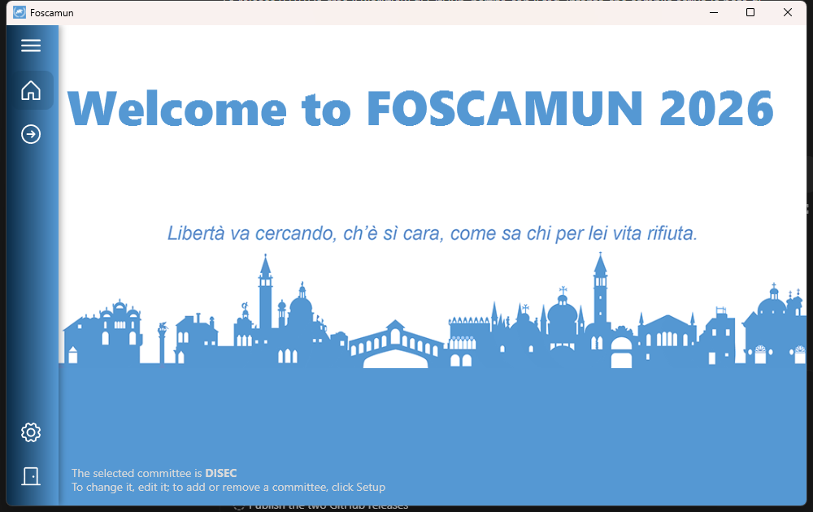
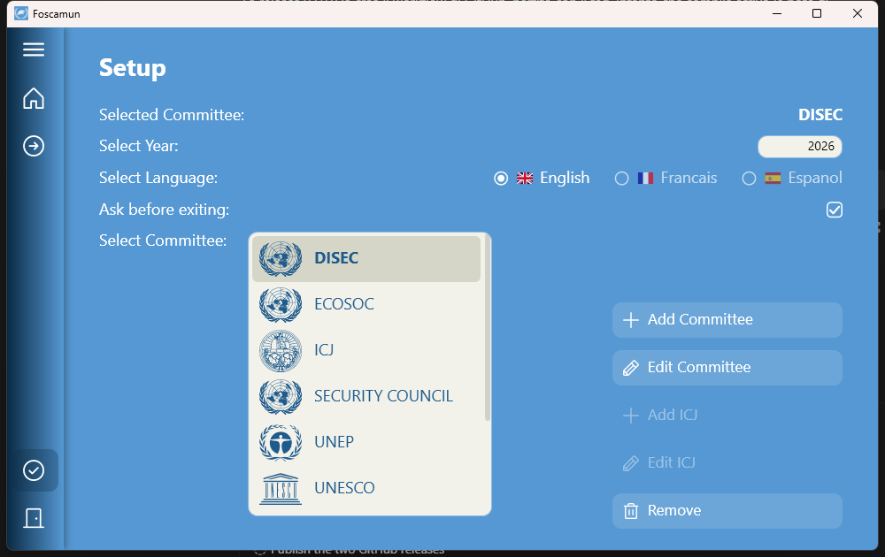
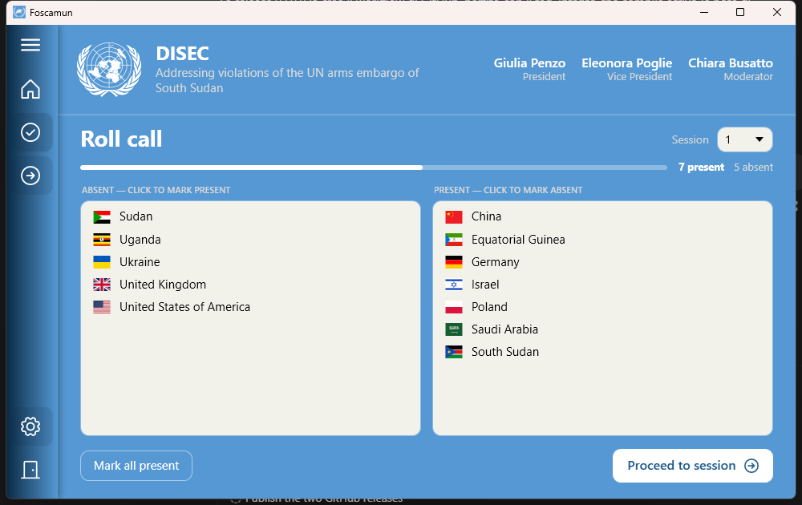
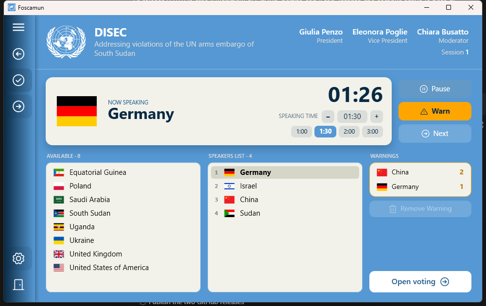
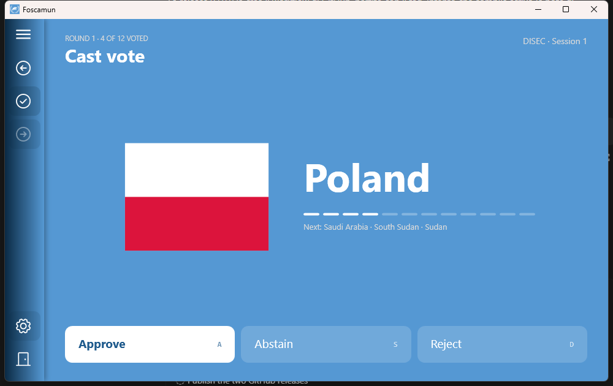
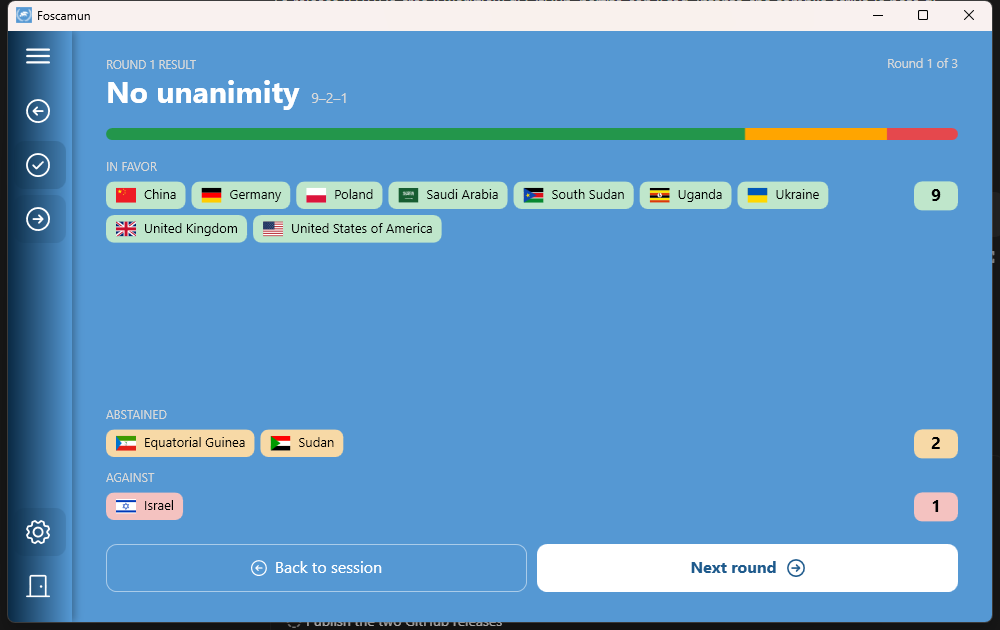
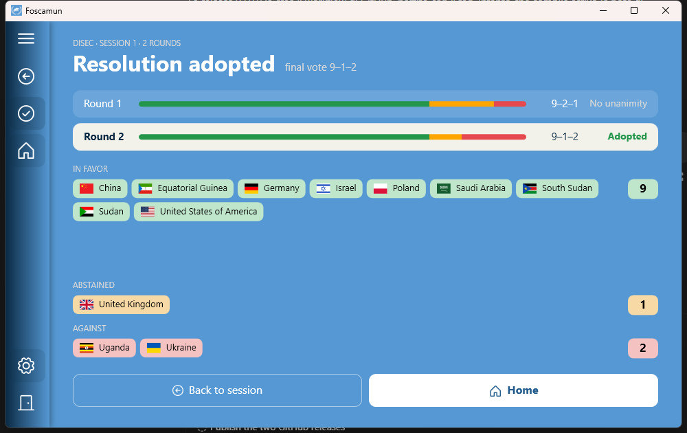

# 🌍 Foscamun - MUN Conference Management System

[](https://dotnet.microsoft.com/download/dotnet/10.0)
[](https://github.com/nanedb/Foscamun)
[](LICENSE)
[](https://github.com/nanedb/Foscamun/releases)

A desktop application for running Model United Nations (MUN) conferences: roll call, speakers list with an integrated timer, warnings, and multi-round voting, for ordinary committees and for the International Court of Justice (ICJ). Built with WPF and .NET 10, in English, French and Spanish.


> **Version 2 brings a completely new interface.** While the choice is being made, both are available: the **new interface** (v2.0.1 and later) and **v1.3.0 — old interface**. They share the same database, so you can try both on the same computer. See [Installation](#-installation).

---

## ✨ Features

### 🧭 Guided flow
- Sidebar showing the previous, current and next page of the flow: Home → Roll call → Session → Voting → Result → Final result
- Setup and Exit always at the bottom; the sidebar collapses to icons only
- Animated page changes, dialogs in the app's own style

### 🏛️ Committee management
- Any number of committees, each with topic, president, vice-president, moderator and participating countries
- Committee emblems as SVG logos, with a generic logo as fallback
- Conference year, language, and "ask before exiting" in Setup

### 📋 Roll call
- Click a country to mark it present or absent, or mark all present at once
- Progress bar with present and absent counts, session number

### 🎤 Session
- Available countries and speakers list side by side: a click moves a country from one to the other
- The head of the speakers list is the current speaker, shown with flag and name
- **Timer built into the page**: speaking time ±15 s, presets 1:00 / 1:30 / 2:00 / 3:00, Start/Pause (also with the space bar), Next; tick and bell sounds; the panel turns orange in overtime
- Warnings per delegate, kept in the database

### 🗳️ Voting
- One delegate at a time, with the keys **A** (approve), **S** (abstain) and **D** (reject)
- Up to three rounds with the MUN rules (see [Voting rules](#-voting-rules))
- **Result** after an undecided round: tally bar, who voted what, back to session or next round
- **Final result**: outcome, every round of the vote in a table, and the decisive round's votes

### ⚖️ International Court of Justice
- Judge and two vice judges, any number of plaintiff and defense advocates (each with the flag of the country they represent), and jurors
- Roll call, session and voting adapted to the court

### 🌐 Languages
- English, French and Spanish, switched at runtime without restarting

### 🔄 Updates and data
- Installer for Windows (per user, no administrator rights) or portable ZIP
- At startup Foscamun checks GitHub for a newer version and offers to download and install it (verified against the published SHA256 checksum)
- The database is kept across installations; if it cannot work with the installed version, a warning explains what to do and nothing is deleted

---

## 🖥️ Screenshots

| | |
|---|---|
|  |  |
|  |  |
|  |  |
|  | |

---

## 📥 Installation

Go to [Releases](https://github.com/nanedb/Foscamun/releases) and choose the version:
- **new interface** — v2.0.1 and later (Latest)
- **v1.3.0 — old interface**

Each release comes in two forms, for Windows 10/11 64-bit (`win-x64`, most PCs), 32-bit (`win-x86`) and ARM (`win-arm64`).

### Installer (recommended)

1. Download `Foscamun-Setup-win-x64-v2.0.1.exe` (or the x86 / ARM64 one)
2. Run it and follow the steps: Foscamun is installed for your user in `%LocalAppData%\Programs\Foscamun`, with a Start menu shortcut (and a desktop one, if you tick it)
3. Uninstall it from **Settings → Apps** like any other program

✅ **No administrator privileges required**
✅ **No .NET installation needed** — self-contained

> Windows may show "Windows protected your PC" because the installer is not signed with a paid certificate: click **More info → Run anyway**.

### Portable ZIP

1. Download `Foscamun-win-x64-v2.0.1.zip` (or the x86 / ARM64 one)
2. Extract it to a user folder (Desktop, Documents, a USB drive…), not `C:\Program Files\`
3. Run `Foscamun.exe`

The ZIP is also the way to keep both interfaces: install the new one and extract **v1.3.0 — old interface** (ZIP only) into a folder of its own.

### Updating

Foscamun updates itself: when a newer release is published it asks at startup, downloads it and restarts. An installed copy is updated with the new installer (silently), a portable copy with the new ZIP.

Your data is not in the application folder but in `%LocalAppData%\Foscamun\` (database `Foscamun.db` and committee logos): installing, updating or uninstalling the program never touches it. The settings (language, year, selected committee) are carried over from the copy you used last.

### Build from source

**Prerequisites:** [.NET 10 SDK](https://dotnet.microsoft.com/download/dotnet/10.0), Windows.

```bash
git clone https://github.com/nanedb/Foscamun.git
cd Foscamun
dotnet restore
dotnet build
dotnet run
```

The new interface lives on the `nuova-interfaccia` branch until it is merged into `master`.

---

## 🚀 Quick start

1. **Setup** (gear icon at the bottom of the sidebar): choose the language and the year, then add a committee with its countries, or add the ICJ
2. Select the committee in the list: it becomes the current committee
3. **Roll call**: mark the delegates present, choose the session number, then *Proceed to session*
4. **Session**: click countries to put them on the speakers list, start the timer, give warnings, *Next* for the next speaker
5. **Open voting**: each delegate votes with A / S / D; the result comes by itself after the last vote
6. **Result / Final result**: go to the next round, back to the session, or home

📖 Step by step: [USER_GUIDE.md](USER_GUIDE.md)

---

## 🗳️ Voting rules

| Round | Committees | ICJ |
|---|---|---|
| 1 | Decided only by **unanimity** | Decided by **majority of the votes cast** (abstentions do not count) |
| 2 | Decided by a **two-thirds majority** of the votes cast | Decided by **simple majority**, no abstaining |
| 3 | **Simple majority**, no abstaining; a tie rejects | **Simple majority**, no abstaining; a tie rejects |

A round that reaches no decision leads to the Result page, from which the next round starts.

---

## 🛠️ Technology

- **.NET 10**, **WPF**, MVVM with **CommunityToolkit.Mvvm**
- **SQLite** through Microsoft.Data.Sqlite (raw ADO.NET)
- **SharpVectors** for SVG flags, icons and logos
- **Microsoft.Extensions.DependencyInjection**

### Project structure

```
Foscamun/
├── Data/            # Database access, schema version check (DatabaseGuard)
├── Models/          # Data models
├── Repositories/    # Committee, country and ICJ repositories
├── Services/        # Update check (UpdateService)
├── installer/       # Inno Setup script of the installer
├── ViewModels/      # MVVM view models
├── Views/           # Pages, shared panels, dialogs
├── Converters/      # WPF value converters
├── Resources/       # Flags, icons, committee logos, sounds
├── Strings/         # Language dictionaries (en, fr, es)
├── Styles/          # Colours, typography, buttons, inputs
├── Fonts/           # Akko Pro
└── Foscamun.db      # Seed database, copied to %LocalAppData% on first run
```

---

## 🎨 Customization

### Committee logos

Logos live in `%LocalAppData%\Foscamun\CommitteeLogo\`. To use your own, save a white SVG on a transparent background named after the committee (e.g. `ECOSOC.svg`) in that folder. Committees without a logo get a copy of `Generic.svg`.

### Languages

The strings are in `Strings\Strings.en.xaml`, `Strings.fr.xaml` and `Strings.es.xaml`. Every new string goes into all three.

---

## 📦 Releasing

Pushing a tag `v*` starts the GitHub Actions workflow that builds the three installers, the three ZIPs, the SHA256SUMS.txt file and the release. The updater relies on the asset names `Foscamun-Setup-{rid}-v{version}.exe` and `Foscamun-{rid}-v{version}.zip` (`rid` = win-x64, win-x86, win-arm64). The installer is made with [Inno Setup 6](https://jrsoftware.org/isinfo.php) from `installer/Foscamun.iss`. See [DEPLOYMENT.md](DEPLOYMENT.md) and [DEPLOYMENT_CHECKLIST.md](DEPLOYMENT_CHECKLIST.md).

---

## 📚 Documentation

- [USER_GUIDE.md](USER_GUIDE.md) — user guide
- [DEPLOYMENT.md](DEPLOYMENT.md) — build and release guide
- [DEPLOYMENT_CHECKLIST.md](DEPLOYMENT_CHECKLIST.md) — release checklist
- [CONTRIBUTING.md](CONTRIBUTING.md) — how to contribute

---

## 🐛 Bugs and requests

- [Report a bug](https://github.com/nanedb/Foscamun/issues/new?labels=bug)
- [Request a feature](https://github.com/nanedb/Foscamun/issues/new?labels=enhancement)

---

## 🔄 Version history

### v2.0.1 (2026-11-08) — new interface
- Windows installer (per user, no administrator rights), next to the portable ZIP
- Installed copies update themselves with the new installer
- Settings carried over from the copy used last, when Foscamun runs from a new folder

### v2.0.0 (2026-11-08) — new interface
- New interface: guided sidebar, redesigned Home, Setup, Roll call, Session, Voting, Result and Final result
- Timer built into the session page; voting with the A / S / D keys; Final result with the history of every round
- Automatic update check and installation from GitHub
- Database compatibility check with a warning, instead of failing

### v1.3.0 (2026-10-28) — old interface
- ICJ: any number of plaintiff and defense advocates, each with their own country
- Taller main window, reduced automatically on small screens

### v1.2.0 (2026-07-02)
- Modernized look on every page, sidebar collapsed at startup
- SQLite security fix (GHSA-2m69-gcr7-jv3q); settings kept when upgrading

### v1.0.0 (2026-03-01)
- First release: committees, ICJ, roll call, session with speakers list and timer, multi-round voting, three languages

Full notes for every version: [Releases](https://github.com/nanedb/Foscamun/releases)

---

## 📄 License

MIT — see [LICENSE](LICENSE).

**Developer**: [nanedb](https://github.com/nanedb)

<div align="center">

**Made with ❤️ for the MUN Community**

[Releases](https://github.com/nanedb/Foscamun/releases) | [User guide](USER_GUIDE.md) | [Report an issue](https://github.com/nanedb/Foscamun/issues)

</div>
